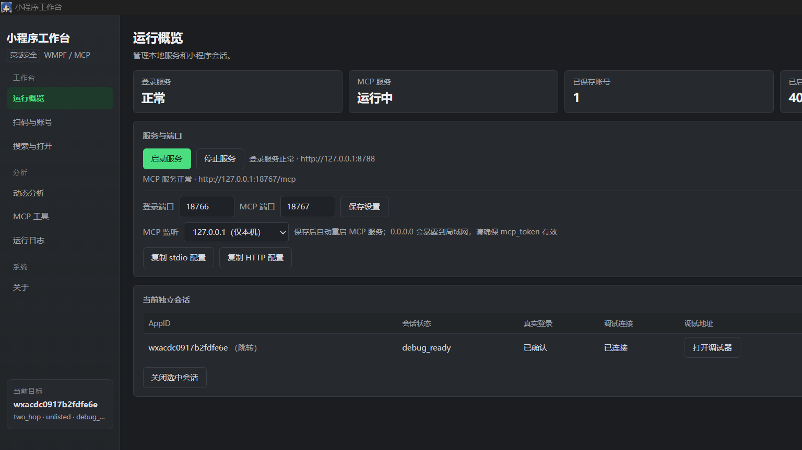
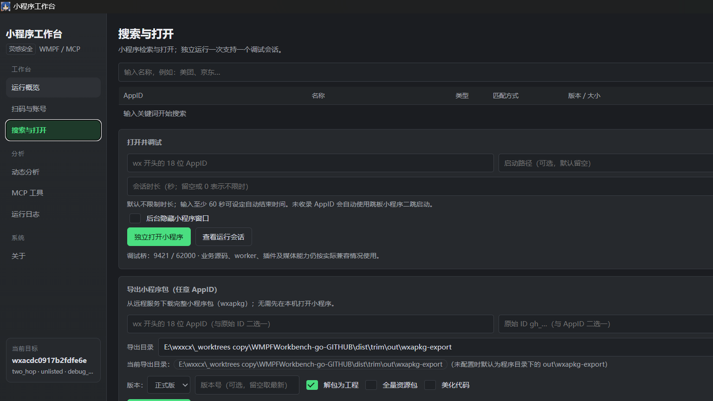
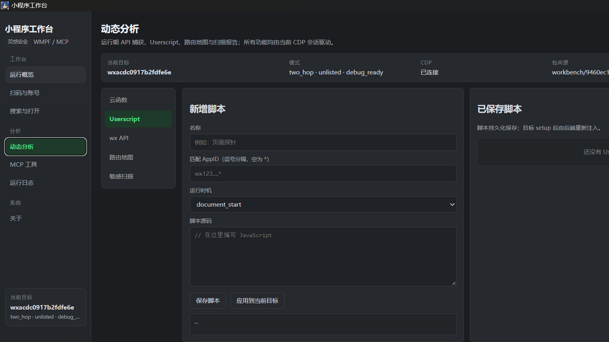
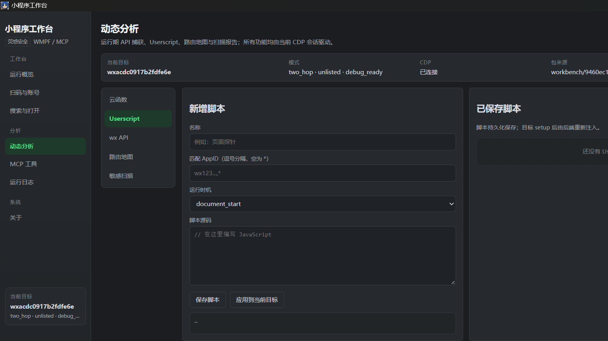

<div align="center">

# 小程序工作台 · WMPFWorkbench-go

**脱离微信独立运行、支持 MCP 的小程序工作台**

<p>
  
  
  
  
  </p>

  **扫码登录 · 小程序搜索 · 独立启动 · 运行时调试 · 代码还原 · 包导出 · Agent 接入**      

> 非官方个人学习与研究作品，与腾讯、微信、应用宝无任何关联。

</div>

---

## 它解决什么问题

做小程序方向的测试，流程往往被切得很碎：找入口用一个工具，调试换一个窗口，想拿代码又得另想办法。

**小程序工作台把这些步骤连起来——从扫码登录到看到代码，中间不需要换程序。** 它把 WMPF 运行时自产宿主化，让小程序脱离微信客户端也能打开和调试，并把全部能力开放成 MCP 接口供 Agent 直接调用。此项目的意义在于提出一个新的方向，为什么小程序逆向时必须要手工在微信中操作？是否可以直接脱离微信？是否可以完全接入agent实现真正的完全自动化？

<div align="center">

| 扫码登录 | 检索 | 独立启动 | 运行时调试 | 代码还原 | 包导出 | Agent 接入 |
|:---:|:---:|:---:|:---:|:---:|:---:|:---:|
| 微信扫码<br>账号仅存本机 | 在线 + 本地<br>离线可查 | 自带宿主<br>脱离微信 | 页面/请求/异常<br>可求值 | 加密包离线<br>还原工程 | 任意小程序<br>在线下载 | 40 个工具<br>MCP 开放 |

</div>

---

## 1.0.5 新增能力

- **任意小程序启动**：已收录 AppID 直启；未收录 AppID 通过可配置 `bridge_appid` 走二跳打开，目标激活后真实关闭跳板，CDP 不再回连跳板。
- **运行期分析**：新增路由地图与跳转守卫、wx API 应用层抓包、云函数捕获与显式重放；捕获记录支持筛选、排序、分页、批量删除和一键重放。
- **自定义脚本**：新增持久 Userscript，保存后按 AppID 在目标 setup 阶段自动注入。
- **敏感信息扫描**：默认规则扩展至 26 条，默认扫描当前打开小程序的已还原源码，支持自定义规则、HTML 报告、分页与原始内容展示。
- **账号与启动稳定性**：统一账号目录，兼容 QR 图片多种返回形式，增加 `-109` 凭据过期诊断；修正 AutoLogin 后的就绪判定，启动更少失败。
- **GUI / MCP**：分组侧栏、白天/黑夜主题、模块化前端文件、DevTools 默认浏览器打开；MCP 扩展至 40 个中文工具。

---

## ⚠️ 能力边界（务必先读）

<div align="center">

> ### 搜索与导出依赖应用宝；启动支持「已收录直启」和「未收录二跳」
>
> **搜索**和 `export_mini_program` 走应用宝在线接口，因此要求目标小程序在应用宝渠道可查。
>
> `launch` 对已收录 AppID 直接申请 `f27` 启动信封并独立启动；对未收录 AppID，会自动使用
> `bridge_appid` 指定的已收录小程序作为跳板，通过二跳流程打开目标并进入可调试 runtime。
>
> 二跳要求跳板小程序在当前环境和版本中可用；可用配置 `bridge_appid` 覆盖默认跳板。
> 二跳成功后，跳板小程序会被真实关闭，避免 DevTools fallback 连回跳板。
>
> `f27` 启动信封由应用宝服务端签发，本项目不构造或破解信封。

</div>

<details>
<summary><b>技术细节：直启与二跳</b></summary>

`launch` 在拉起宿主之前，会先调用应用宝的 `/pc_yyb_client/pcyyb_get_app_detail` 校验 appid：

- 服务端返回 `data.apps` 中存在目标 appid → 调用 `/v3/pcyyb_encrypt_wx_mini_program_launch_param`
  申请 `f27` 信封（`iv/data/timestamp/authtag`），本地直接启动；
- 未收录时 → 使用 `bridge_appid` 启动已收录跳板，等待跳板 ready 后通过 JS bridge
  `navigateToMiniProgram` 打开目标，目标 active 后关闭跳板。

本地只做签名请求、protobuf 封装和流程编排，不构造或破解 `f27` 信封内容。

相关代码：`native/internal/launch/inputs.go`、`native/internal/core/service.go`。

</details>

---

## 界面预览

<div align="center">

### 运行概览
服务状态、会话状态与 MCP 配置一键复制；深色/浅色主题自动跟随系统



<br><br>

### 搜索与打开
应用宝在线搜索；已收录 AppID 可直启，未收录 AppID 通过二跳打开并进入可调试 runtime



<br><br>

### 动态分析
云函数、Userscript、wx API、路由地图与敏感扫描集中管理



<br><br>

### wx API 抓包
按 HTTP 语义展示请求/响应，支持筛选、排序、分页、批量删除与重放



</div>

---

## 快速开始

### 1. 依赖

| 依赖 | 说明 |
|:---|:---|
| Windows 10/11 x64 | 仅支持 Windows |
| **WMPF 运行时 5.10.7300.414** | **必需但不在本仓库分发**；可从专用仓库 [5.10.7300.414](https://github.com/yiyihuohuo/5.10.7300.414) 下载，详见下方 |
| Go 1.23+ | 构建登录服务与 MCP/GUI |
| Visual Studio 2022 x64 C++ 工具链 | 构建 C++ 宿主与观测 worker（vswhere 自动查找） |
| WebView2 Runtime | GUI 使用，系统通常已自带 |
| `wxapkg-dump.exe` | Release 包已内置；从源码构建需自行提供或配置 `dump_exe` |
| Chrome / Edge | GUI 打开 DevTools 时需要；系统默认浏览器用于最终展示页面 |

### 2. 运行时依赖（重要）

<details open>
<summary>本项目依赖一整套 WMPF 运行时（约 386 MB），<b>不随主仓库或 Release 分发</b>；已单独发布到 https://github.com/yiyihuohuo/5.10.7300.414 。</summary>

**先澄清一个容易困惑的点：目录里有 `WeChatAppEx.exe`、`flue.dll`、`wxgame_client.dll` 等微信名字的文件，为什么还说"从应用宝 PC 获取"？**

WMPF 是微信团队开发的"小程序容器"引擎，以微信命名，但作为通用组件被打包进多个腾讯产品（微信桌面端、企业微信、应用宝 PC）。**同一套引擎，不同产品携带的版本不同**。本项目 `hostruntime/validate.go` 锁定了 5 个文件的 SHA-256（`flue.dll`、`wmpf_host_export_x64.dll`、`libamssdk.dll`、`pcyyb_sdk_dll.dll`、`WeChatAppEx.exe`），实测结果：

| 来源 | 校验结果 |
|---|---|
| 微信桌面端 4.2.0.52 RadiumWMPF（flue 2.5.8.26134） | 5 个文件全部不匹配 |
| 微信桌面端 3.x RadiumWMPF | 不匹配，且缺 3 个文件 |
| 企业微信 wmpf_Applet 2.1.4.x | 不匹配 |
| **应用宝 PC 的 `WmpfRuntime\5.10.7300.414\`** | **5/5 精确匹配** |

所以"应用宝"指的是**获取渠道**——只有这份 5.10.7300.414 能过校验并工作；文件名带 `WeChat` 是引擎产品命名，两者不矛盾。目录里的 `file_component.xml` 也标注了 `appClientId="UniWeChatWin"`、子插件 `PcYybSdk`（PC 应用宝 SDK），正是这套引擎被应用宝集成的证据。

**为什么必须是整目录，不是只拷几个 DLL**：`flue.dll`（201 MB）是 Chromium 级浏览器引擎，它启动时会拉起同目录的 `WeChatAppEx.exe`，并依赖图形栈（`libEGL`/`libGLESv2`/`vk_swiftshader`/`dxcompiler`）、资源包（`wmpf_resources.pak` 26 MB、各 `.pak`、`icudtl.dat`）。缺任何一项，renderer 起不来或 CDP 连不上。`validate.go` 只校验 5 个关键文件是**版本指纹**，但运行需要的是完整环境。

获取步骤：

1. 打开运行库专用仓库：https://github.com/yiyihuohuo/5.10.7300.414 ；
2. 下载仓库内容（约 386 MB，含 `host\` 与 `runtime\`）；`flue.dll` 使用 Git LFS 存储；
3. 将该目录整体放到工作台根目录的 `runtime\5.10.7300.414\`。

也可以从应用宝 PC 安装目录中复制同版本目录，但专用仓库更便于复现和校验。

没有该运行时，登录 / 搜索 / 源码还原可用，但 **独立启动与调试无法工作**。仓库 `.gitignore` 已排除 `runtime/`、`data/`、`dist/`、`build/`，这些运行态文件不会被提交。

</details>

### 3. 构建

```powershell
powershell.exe -NoProfile -ExecutionPolicy Bypass -File native\build-release.ps1
```

脚本会先编译 C++ 宿主、Frida worker、wxapkg 工具并拷入 `native/internal/bundle/bin/`（`go:embed` 输入），再产出一个自包含的 **`wmpf-gui.exe`**：它同时提供桌面 GUI 与 MCP 服务（`-mcp stdio|http`）。`bundle/bin` 下的 exe 不入库，由构建脚本生成。

### 4. 使用

1. 运行构建出的 `wmpf-gui.exe`，在「运行概览」确认登录服务、MCP 服务均正常。
2. 在「扫码与账号」生成二维码，用微信扫码并在手机确认；账号保存到本机，每 5 分钟自动检查并按需更新票据。
3. 在「MCP 工具」查看工具列表、参数与启用条件；可搜索、分组、逐项或批量开关。禁用会同时约束发现与调用。
4. 在「搜索与打开」**搜索应用宝收录的小程序**并选中结果独立打开；概览显示启动 / 登录 / 调试状态。可勾选「后台隐藏小程序窗口」，隐藏后仍可通过 CDP 调试。一次支持一个会话，默认最长 30 分钟。
5. 同一页面的「导出小程序包」区域可**导出任意小程序的完整 wxapkg**（输入 appid 或选中搜索结果，设置导出目录，可选版本类型 / 解包 / 美化）。导出为后台任务，界面显示真实的分包/文件进度；无需先成功启动该小程序。
6. 在概览复制 HTTP 或 stdio 配置给 Agent。推荐 HTTP，与 GUI 共用运行会话；stdio 会创建独立进程，共享账号与开关但会话独立。

> 端口：调试桥 `9421` / `62000`，MCP `18767`，登录服务 `18766`。端口占用时先停止服务并在概览更换后重启。
>
> **MCP 监听地址**：在「运行概览 → 服务与端口」可选择 `127.0.0.1`（仅本机，默认）或 `0.0.0.0`（允许局域网访问）。保存后 MCP 服务会自动重启并立即按新地址监听。`0.0.0.0` 会把服务暴露到局域网，请确保 `mcp_token` 有效且仅在可信网络中使用；复制的 HTTP 配置仍以 `127.0.0.1` 为目标，跨设备访问时需手动改为运行机器的局域网 IP。

> **二跳跳板配置**：配置文件中的 `bridge_appid` 用于未收录小程序的二跳启动。默认值仅用于开箱即用；如果默认跳板在当前网络/版本中不可用，请改为一个已收录且可正常启动的 AppID。

---

## MCP 工具（18 个）

| 分组 | 工具 |
|:---|:---|
| 搜索与索引 | `search_mini_programs` · `get_app_detail` · `index` |
| 账号 | `login_status` |
| 运行时 | `launch` · `close_runtime` · `runtime_status` |
| 调试 | `cdp_connect` · `cdp_evaluate` · `cdp_send` · `cdp_events` · `cdp_local_targets` · `cdp_scripts` |
| 源码 | `decrypt_wxapkg` · `extract_api_surface` |
| 包导出 | `export_mini_program` · `export_status` |
| 网络 | `netlog` |

完整参数说明见 [MCP 工具说明](docs/MCP工具说明.md)。源码有两条路：`decrypt_wxapkg` 离线还原本机已有的 `wxapkg`；或经 `cdp_events` 取 `scriptId` 后用 `cdp_scripts` 分页读取运行时明文。`Page.getFrameTree` 因当前引擎已确认的崩溃问题明确禁用。

**任意小程序包导出**：`export_mini_program` 通过本地授权会话从应用宝远程下载完整 `wxapkg`（按 `appid` 或 `username`，可选正式/体验/开发/预览版，可连带解包还原工程）。任务是**异步**的：提交立即返回 `task_id`，用 `export_status` 轮询进度与结果；进度为真实数据（来自 sidecar 事件流的分包/文件计数，而非估算）。该能力依赖 `wxapkg-dump` sidecar（见 [REFERENCES.md](docs/REFERENCES.md)），并与"能否独立启动"无关——未在应用宝上架或启动失败的小程序，只要远端有包仍可导出。

---

## 已知限制

- **仅支持应用宝渠道收录的小程序**（搜索与启动均如此），详见上方 [能力边界](#️-能力边界务必先读)。
- `f27` 启动信封由应用宝服务端签发，本项目不含也无法生成服务端密钥。
- 部分小程序的 worker、插件与媒体能力以实际兼容情况为准；还原产物是运行时结果，不等同官方工程。
- 当前运行环境由已初始化环境整理，不能据此宣称全新环境初始化、全天自然到期保活、任意小程序 / AppService / worker / 插件 / 媒体 / 跨版本均通过。

---

## 工程结构

```text
WMPFWorkbench-go/
  native/cmd/workbench-gui      单 exe：桌面 GUI + 内嵌 MCP 服务（stdio / HTTP）
  native/internal/launch        启动输入（f27 信封、登录票据）准备
  native/internal/hostruntime   自产会话生命周期管理
  native/internal/bundle        内嵌 helper（go:embed，不入库）
  native/worker                 C++ Frida 观测 worker 源码
  native/services/login         Go 登录协议 / HTTP / 数据库
  hostcpp/                      C++ 自产宿主源码与构建脚本
  vendor/KillWxapkg/            Ackites/KillWxapkg (MIT) 离线解密源码
  tools/                        启动观测、调试桥与验证脚本
  data/ dist/ build/ out/       运行态与构建产物（.gitignore 排除，不提交）
```

## 开源协议

本项目采用 **Apache-2.0** 授权（见 [LICENSE](LICENSE)、[NOTICE](NOTICE)）：可自由使用、修改、分发（含商业用途），并附带明确的专利授权；要求是保留版权声明、许可文本与 `NOTICE` 归属声明，修改文件需注明变更。

第三方依赖各自遵循其原许可：Frida 为 LGPL-2.1（静态链接，见 [FRIDA_RELINK.md](docs/FRIDA_RELINK.md)），KillWxapkg 为 MIT，其余见 [THIRD_PARTY_NOTICES.md](docs/THIRD_PARTY_NOTICES.md)。下方「免责声明」是使用责任声明，不构成对许可条款的额外限制——两者冲突时以 [LICENSE](LICENSE) 为准。

## 第三方组件与许可

本项目依赖 Wails v2（MIT）、gorilla/websocket（BSD-3）、MCP Go SDK（MIT）、modernc.org/sqlite（BSD-3）、**Frida（LGPL-2.1+，静态链接进观测 worker）**、KillWxapkg（MIT）、[wxapkg-dump](https://github.com/RYF5584/wxapkg-dump)（MIT，授权登录与在线包导出的 sidecar）等。完整清单见 [REFERENCES.md](docs/REFERENCES.md)，许可义务见 [THIRD_PARTY_NOTICES.md](docs/THIRD_PARTY_NOTICES.md)，Frida 的 LGPL 对应源码与可重链接指引见 [FRIDA_RELINK.md](docs/FRIDA_RELINK.md)。分发二进制前请自行核对相应许可义务。

## 隐私

本项目不上传任何账号、票据或日志。运行时的 `data/`（账号库、配置、会话）仅保存在本机且已被 `.gitignore` 排除。界面只显示脱敏后的账号标识，不提供完整 OpenID 复制入口；票据在会话结束时清理，操作日志对账号与 token 做脱敏。

---

**免责声明**

1. 本软件仅供个人学习、研究与安全技术交流使用，不得用于商业用途或任何非法目的。
2. 使用本软件分析的小程序、应用与数据，须为本人所有或已获得权利人明确授权；未经授权不得抓取、复制、存储或传播他人数据与个人信息。
3. 使用本软件应自行遵守《中华人民共和国网络安全法》《数据安全法》《个人信息保护法》等法律法规以及微信、腾讯的服务条款。因违规或不当使用产生的一切后果由使用者自行承担，开发者不承担任何直接或间接责任。
4. 本软件按「现状」提供，不附带任何明示或默示担保；使用前应自行评估风险并做好数据备份。

## 交流与反馈

- **公众号**：荧惑安全（工具更新、技术文章与问题答疑）
- **QQ 群**：1130438692（使用问题、功能建议、交流小程序安全研究）

提问题或功能建议，欢迎在公众号留言或加入 QQ 群。提交 Issue 前建议先查阅 [MCP 工具说明](docs/MCP工具说明.md) 与已知限制。

<div align="center">

<sub>小程序工作台 · 登录、独立启动、CDP 调试与离线解密的一体化工作台</sub>

</div>
